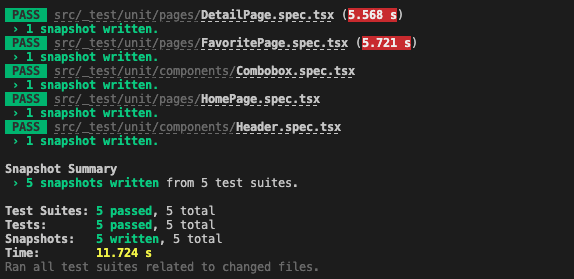
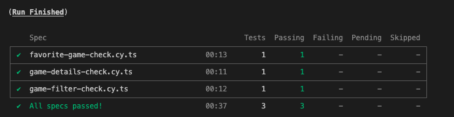
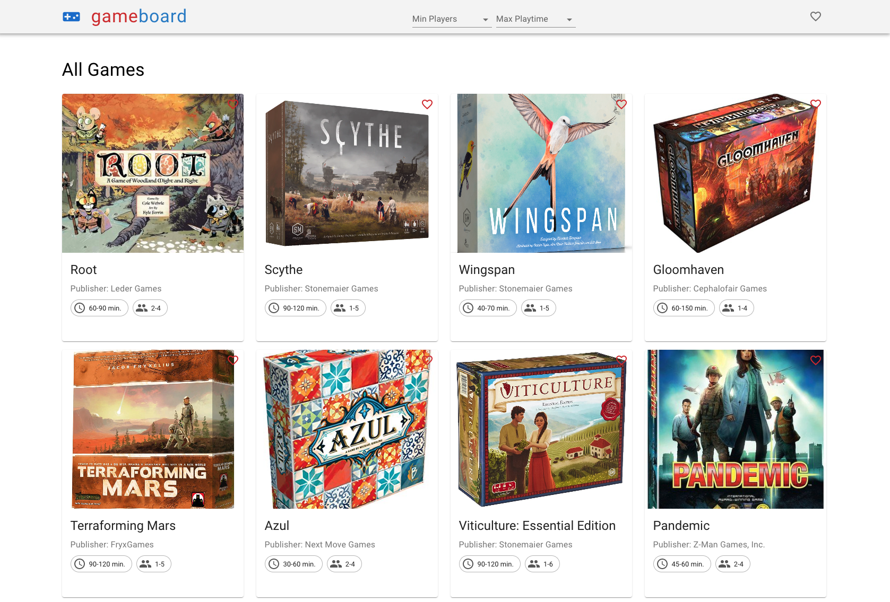
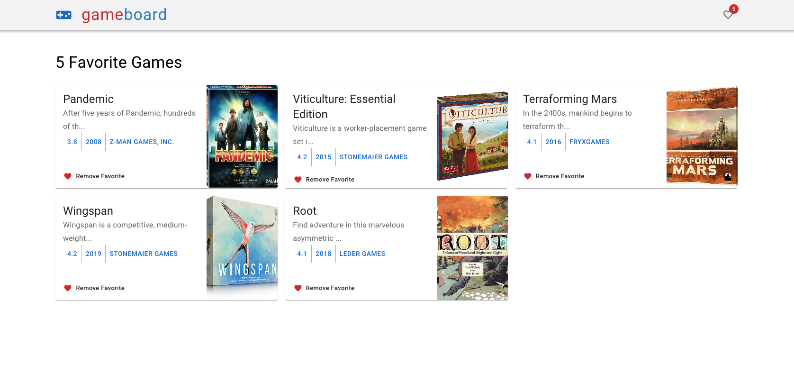
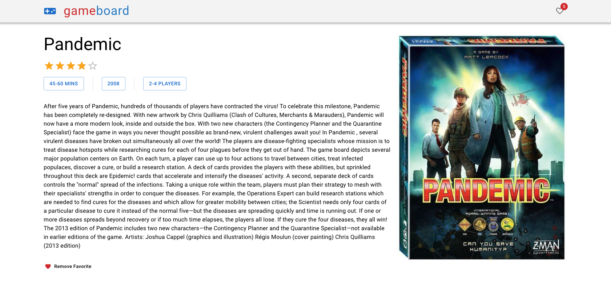

# Getting Started with Game Board App

This project was bootstrapped with [Create React App](https://github.com/facebook/create-react-app).

## Available Scripts

In the project directory, you can run:

### `Install project packages`

```shell
npm install
# or
yarn
```

### `Start project`

```shell
npm run start
# or
yarn start
```

Runs the app in the development mode.\
Open [http://localhost:3000](http://localhost:3000) to view it in the browser.

The page will reload if you make edits.\
You will also see any lint errors in the console.

### `Test project`

```shell
npm run test
# or
yarn test
```

Launches the test runner in the interactive watch mode.\
See the section about [running tests](https://facebook.github.io/create-react-app/docs/running-tests) for more information.



## `e2e`

Launches the cypress app interface for e2e tests.



```shell
npm run test:e2e:open
# or
yarn test:e2e:open
```

Runs the e2e tests.

```shell
npm run test:e2e:run
# or
yarn test:e2e:run
```

## Project ScreenShots

### Home & Search Page



### Favorite Page



### Detail Page



## Used Tools/Packages

- React
- Typescript
- MUI
- Redux Toolkit
- RTK Query
- Eslint
- React Router
- Redux Persist
- Cypress
